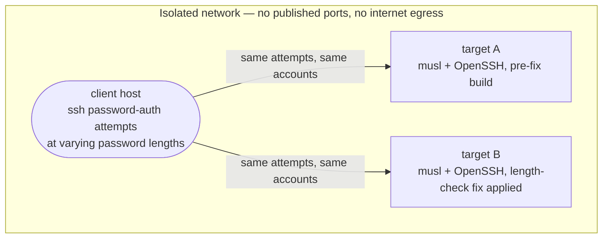
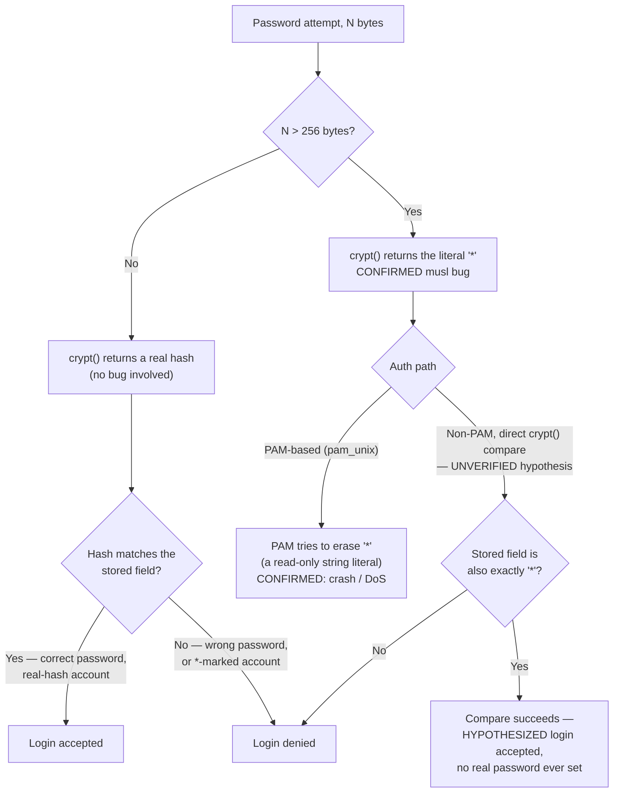

# musl `crypt()` Overflow and a Hypothetical SSH Password-Bypass Chain

[Repository home](../README.md) · [CVE reports index](README.md)

musl libc's `crypt()` has a confirmed failure mode: for a password longer than
256 bytes, its SHA-256/SHA-512-crypt code returns the literal string `"*"`
instead of a hash or an error code. That return value is documented to cause
a crash in PAM (see [Sources](#sources)). This note also walks through a
**hypothesis**, not a confirmed public vulnerability: whether that same `"*"`
return value could, under specific preconditions, be made to match a
disabled account's password-disabled marker and let an attacker log in over
SSH without a real password. Treat the crash as fact and the login-bypass
chain as an unverified, lab-constructed scenario — searches of NVD, Alpine's
advisories, and OpenSSH's changelog turned up no public report of it, and no
CVE identifier for it could be confirmed.

## Core concepts

### How crypt()-based password checks normally work

Classic Unix password authentication stores a salted hash, not the password
itself. To check a login attempt, the system recomputes
`crypt(candidate_password, stored_salt)` and compares the result to the
stored hash with a plain string comparison. If they match, the password was
correct. This only works safely if `crypt()` either returns a real hash or
clearly signals failure — a comparison against anything else assumes the
return value is trustworthy.

### The `*` / `!` "account disabled" convention

By convention, `/etc/passwd` and `/etc/shadow` use short, hash-shaped-but-not-a-hash
markers such as `*` or `!` in the password field to mean "this account has no
usable password; password logins must never succeed." No real salted hash
can ever be 1 byte long, so under normal operation a comparison against `*`
or `!` always fails — there's no salt for which `crypt()` would output that
exact string. [Linux password hashes](../notes/cryptography/linux_user_hashes.md)
covers the on-disk format and these markers in more detail.

### The confirmed bug: an input length collapses the output to one of those markers

That assumption — "crypt() output never equals a disabled-account marker" —
is exactly what breaks in musl. Its SHA-256/SHA-512-crypt implementation uses
a fixed-size internal buffer; sha512crypt code paths that handle inputs over
256 bytes fall through to a failure path that returns the single-character
string literal `"*"` rather than computing a hash or returning `NULL` (the
POSIX way to signal an error). A password of 257 or more bytes, run through
`crypt()` against *any* salt, produces exactly `"*"` — this is a real,
documented defect (reported against Alpine 3.21 in December 2024; see
[Sources](#sources)), confirmed there to crash PAM when it tries to
zero out that read-only string literal.

### The hypothesis: using the collision for an authentication bypass

The crash above happens because something *tries to erase* the returned
`"*"`. The open question this note explores — without a confirmed public
source backing it — is what happens in a code path that does **not** erase
that value, but instead directly string-compares it against the account's
stored password field, the way the classic crypt()-based check above does.
If an account's stored marker is `*` and an attacker supplies a password
over 256 bytes, `crypt()` returns `*` too — and a plain string comparison
would accept it as a match, despite no password having ever been set.

Whether any shipped, PAM-free SSH password-authentication path actually
performs that unguarded comparison is the unverified part of this note. If
it does, the following preconditions would all need to hold simultaneously
for the bypass to work — each one narrows the exposure a lot:

- The target uses musl's `crypt()` directly (musl-based distros: Alpine,
  OpenWrt, Buildroot/Yocto-derived images) — glibc's `crypt()` does not have
  this bug, so mainstream server distros built on glibc are not exposed via
  this specific path at all.
- The SSH daemon's password authentication calls `crypt()` and compares the
  result itself, rather than going through PAM — most mainstream Linux
  distributions route SSH password logins through PAM (`pam_unix`), which
  does its own validation and, per the confirmed bug, would crash rather
  than silently accept.
- An account's stored password field is set to exactly a bare `*`/`!`
  marker directly in `/etc/passwd`'s own password field — distros that keep
  that field as `x` and store the real marker only inside `/etc/shadow` are a
  different, separate record, and the shadow-lookup and salt-selection
  helpers most C libraries use internally would still need to be checked
  independently; they are not guaranteed to preserve the collision.
- The authentication service's own maximum accepted password length (many
  services cap this somewhere between 128 and 1024 bytes) is high enough to
  let a 257+ byte attempt through to `crypt()` at all.

### The fix that would close the gap, if it exists

Whether or not the specific SSH chain above is real anywhere, the underlying
defensive fix is simple and general: before trusting a `crypt()` comparison
as a positive match, check that the *stored* field is long enough to be a
plausible hash (a handful of bytes, at minimum) and reject the comparison
outright if it isn't — regardless of what `crypt()` returned for the
candidate. That closes the class of bug, not just this one input length, and
doesn't depend on musl ever changing its `"*"`-on-overflow behavior.

## Practical example

This reproduces the **confirmed** part only: musl's `crypt()` returning `"*"`
for an over-length input. It needs a musl-libc environment (e.g., an Alpine
VM or container you set up yourself — no specific build is provided here).
Do not run password or authentication experiments against any system you do
not own or have explicit permission to test.

### Lab setup used to test this

The reproduction behind this note used three isolated hosts (containers, in
this case) on one private network: one running musl plus an OpenSSH build
from before any length-based fix, one running the same stack after a
length-based fix, and a third acting purely as the SSH client sending test
attempts to the other two. No host ports were published and the network had
no route to the internet, so the only thing reachable from the client was
the two targets.



Both targets carry the same two account types — one ordinary account with a
real password hash, one account whose password field is a bare `*` marker —
so that every password-length attempt below can be run unmodified against
both targets and only the fix, not the setup, differs between the two
results.

### How each attempt was evaluated

Every attempt is the same shape — a password of some length, sent to one of
the two account types — and the diagram below is the decision tree the test
matrix in the table further down walks through. The confirmed branches
(a real hash comparing, and the musl bug firing on the PAM path) are backed
by the sources at the bottom of this note; the non-PAM branch is the
unverified hypothesis this note is explicit about.



**1. Confirm the root cause directly, with no authentication service
involved at all:**

```c
/* crypt_probe.c — demonstrates musl's crypt() overflow behavior */
#define _XOPEN_SOURCE
#include <crypt.h>
#include <stdio.h>
#include <string.h>

int main(void) {
    char long_pw[400];
    memset(long_pw, 'A', sizeof(long_pw) - 1);
    long_pw[sizeof(long_pw) - 1] = '\0';   /* 399 bytes, past the 256 cutoff */

    char short_pw[200];
    memset(short_pw, 'A', sizeof(short_pw) - 1);
    short_pw[sizeof(short_pw) - 1] = '\0'; /* 199 bytes, under the cutoff */

    printf("long  (399B): %s\n", crypt(long_pw,  "$6$somesalt$"));
    printf("short (199B): %s\n", crypt(short_pw, "$6$somesalt$"));
    return 0;
}
```

```sh
cc -o crypt_probe crypt_probe.c -lcrypt   # omit -lcrypt where crypt() is in libc itself
./crypt_probe
```

- On a musl-libc host (e.g., Alpine): the long password prints the literal
  `*`; the short one prints a normal `$6$somesalt$...` hash.
- On a glibc host, both print a normal hash — the bug is specific to musl's
  implementation.

**2. If testing the bypass hypothesis, set up accounts to match the stated
preconditions:** one ordinary account with a real password hash, and one
account whose password field is set to a bare `*` directly in the local
account database, with no separate shadow entry for it.

**3. Attempt a password login to the `*`-marked account** at a few password
lengths, using an SSH client configured for password authentication only
(disable public-key and interactive-keyboard methods so you're testing the
password path specifically):

| Attempt | Password length | Expected if the hypothesis holds | What it would demonstrate |
|---|---|---|---|
| Control | correct password, ordinary account | Login succeeds | Password auth works at all |
| Control | wrong password, ordinary account | Denied | Baseline negative control |
| Boundary | 256 bytes, `*`-marked account | Denied | Still under musl's cutoff; a real hash is computed and can't match `*` |
| Bypass attempt | 257+ bytes, `*`-marked account | **Login succeeds** | `crypt()` returns `*`, and the service compared it to the stored `*` without checking it was a plausible hash first |
| Patched target | same 257+ byte attempt against a build with the length-based guard | Denied | The guard rejects the comparison before `crypt()`'s output even matters |

**Limitations:** this only exercises the hypothesis described above, under
every precondition listed in [Core concepts](#the-hypothesis-using-the-collision-for-an-authentication-bypass).
If any precondition doesn't hold on a given target — most commonly, if the
SSH daemon's password path goes through PAM — the outcome is a PAM crash
(the confirmed bug) rather than a successful login, or no effect at all.
Do not treat a successful reproduction in a private lab as evidence of a
real-world, unpatched, publicly disclosed vulnerability without independent
confirmation from the vendor or a recognized vulnerability database.

## Related notes

- [Linux password hashes](../notes/cryptography/linux_user_hashes.md)
- [Authentication models and physical security](../notes/basics/authentication_models.md)
- [Passwords](../notes/pentesting/passwords/README.md)

## Sources

- [musl mailing list: "crypt() SHA/SHA256/SHA512 edge case" thread, Dec 2024](https://www.openwall.com/lists/musl/2024/12/29/3) — Runxi Yu's original report that `passwd` segfaults on Alpine 3.21 with a password over 256 characters, traced to musl's `crypt()` returning the string literal `"*"` and PAM then trying to erase it.
- [musl mailing list, same thread, Dec 2024](https://www.openwall.com/lists/musl/2024/12/31/2) — Markus Wichmann and Rich Felker's follow-up discussion of the 256-byte limit and the `"*"`-on-failure behavior in musl's sha512crypt code.

No source confirms a public CVE identifier, an OpenSSH advisory, or a
real-world authentication bypass built on this bug; the login-bypass section
above is this note's own hypothesis, not a cited finding.
